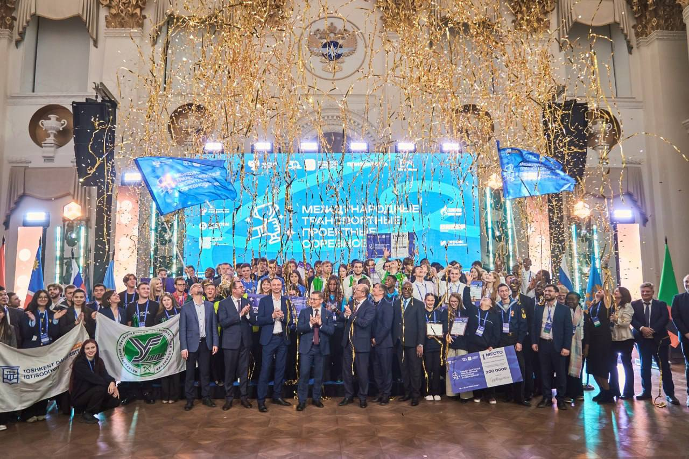
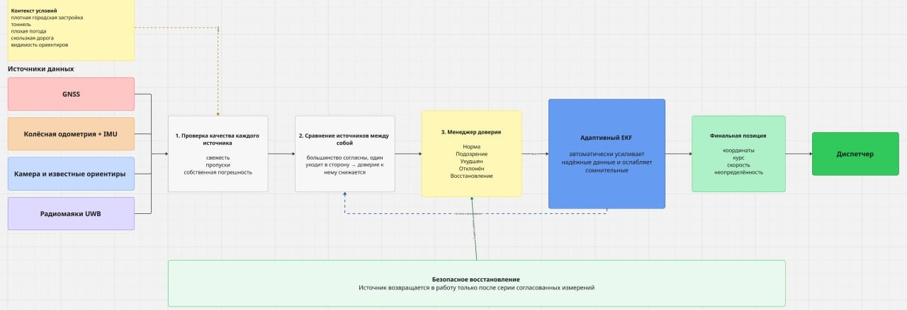
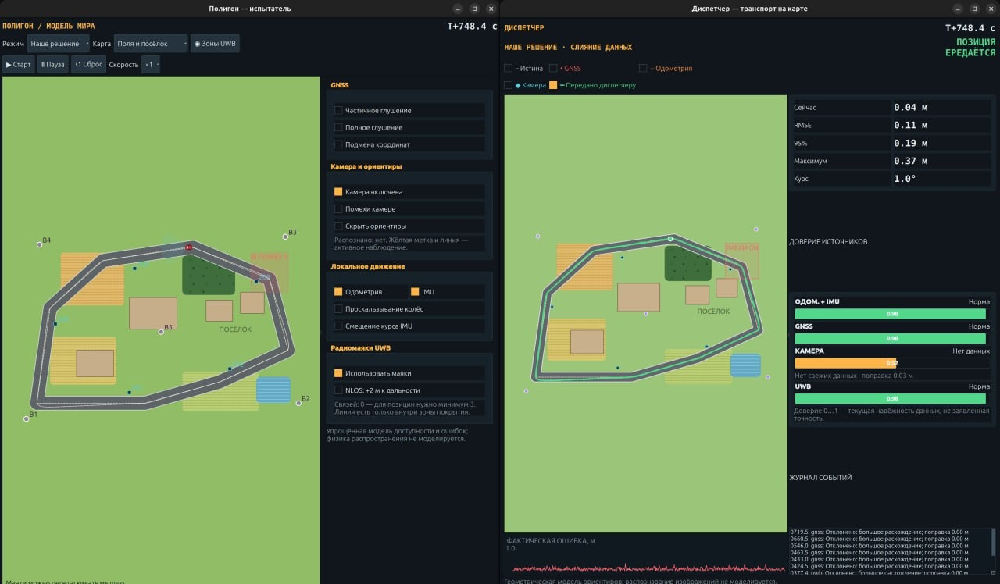
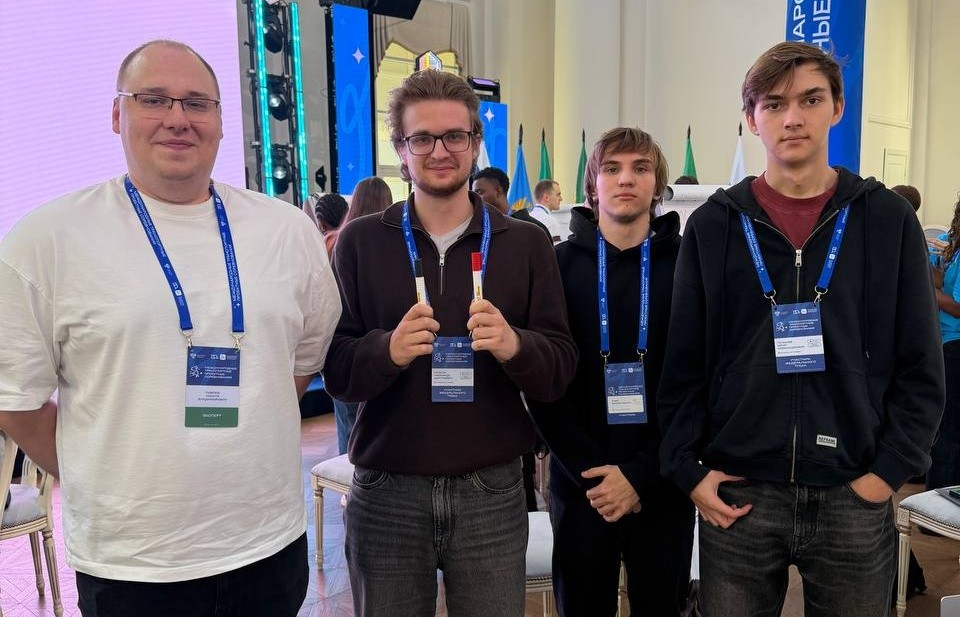
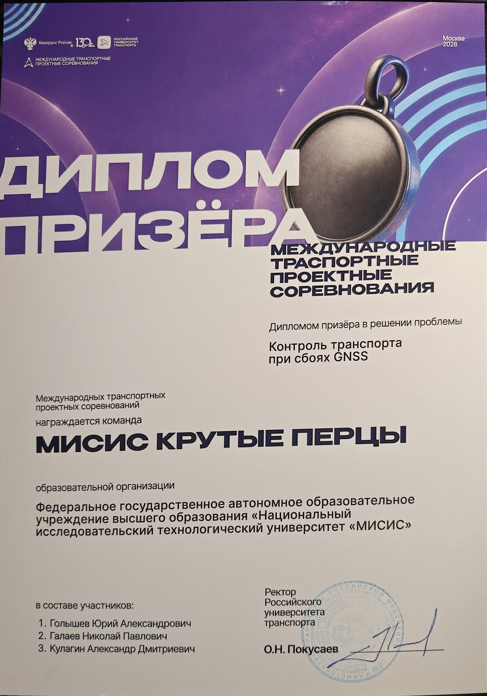
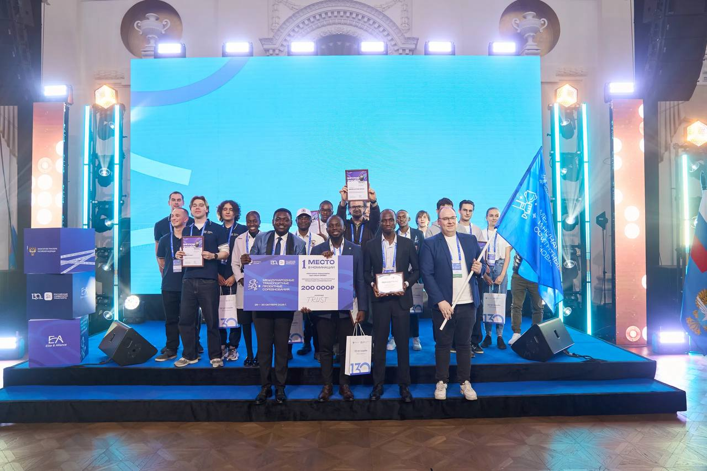

# Устойчивое позиционирование транспорта при сбоях GNSS

Проект команды **«МИСИС крутые перцы»** из НИТУ МИСИС для Международных
транспортных проектных соревнований РУТ (МИИТ). Заказчик кейса № 4 —
**ФАУ «РОСДОРНИИ»**.

<p align="center">
  
</p>

## О кейсе

Интеллектуальные транспортные системы получают координаты транспорта через
GNSS. В тоннелях, плотной городской застройке, при помехах или подмене сигнала
машина может исчезнуть с цифровой карты либо оказаться в неверной точке, которой
система продолжает доверять.

Наша задача — сохранить оценку положения, направления и скорости транспорта,
а также явно сообщить диспетчеру, когда качество координат ухудшилось.

Ключевая проблема не только в полном исчезновении сигнала. Опаснее ситуация,
когда GNSS продолжает выдавать правдоподобные, но неверные координаты. Поэтому
решение должно не просто иметь резервный датчик, а постоянно оценивать качество
всех доступных источников и не позволять одному из них незаметно увести итоговую
позицию.

## Для кого мы делаем решение

- **Диспетчеры региональных ИТС** — чтобы непрерывно видеть транспорт на карте и
  не принимать ложную координату за достоверную.
- **ФАУ «РОСДОРНИИ», владельцы и эксплуатанты дорог** — чтобы проверять
  сценарии потери GNSS и формировать измеримые требования к системам.
- **Разработчики беспилотного и подключённого транспорта** — чтобы подключать
  резервные источники позиционирования без полной замены бортовой системы.
- **Логистические и транспортные компании** — чтобы сохранять контроль маршрута
  на проблемных участках.

## Наше решение

Мы разработали демонстратор **гибридной локализации с адаптивным контролем
доверия**. Он объединяет:

- GNSS;
- колёсную одометрию и IMU;
- камеру и известные визуальные ориентиры;
- радиомаяки UWB на критических участках.

Каждый источник сначала проверяется по свежести, собственной неопределённости и
согласованности с другими источниками. Менеджер доверия в реальном времени
ослабляет сомнительные данные, а адаптивный EKF формирует итоговую позицию и её
неопределённость. Источник после сбоя возвращается в работу только по серии
согласованных измерений.

## Логика работы решения

### 1. Получение независимых измерений

| Источник | Что даёт системе | Основное ограничение |
|---|---|---|
| **GNSS** | Абсолютные координаты на карте | Глушение, отражения в городе, скачки и плавная подмена координат |
| **Одометрия + IMU** | Непрерывный прогноз движения, скорости и курса | Ошибка постепенно накапливается, возможны проскальзывание и дрейф гироскопа |
| **Камера** | Абсолютная привязка по известным дорожным ориентирам | Ориентир должен находиться в поле зрения и быть нанесён на карту |
| **UWB** | Дальности до радиомаяков и внешняя координатная привязка | Требуются покрытие и достаточная геометрия нескольких маяков |

Одометрия и IMU отвечают за непрерывность движения между внешними привязками.
GNSS, камера и UWB периодически корректируют накопленный дрейф, когда их данные
доступны и согласованы.

### 2. Первичная проверка каждого источника

Для каждого пакета система проверяет:

- свежесть и возраст измерения;
- пропуски и доступность источника;
- заявленную ковариацию — собственную неопределённость измерения;
- физическую правдоподобность поправки;
- ожидаемые условия участка, например повышенный риск ошибок GNSS в плотной
  городской застройке.

Контекст местности не сообщает алгоритму, что конкретное измерение ошибочно. Он
лишь заставляет осторожнее относиться к источнику, для которого в этих условиях
ожидаются проблемы.

### 3. Сравнение источников между собой

Алгоритм не знает истинную позицию автомобиля. Он сравнивает доступные измерения
друг с другом и с локальным прогнозом движения. Если одометрия, камера и UWB
показывают согласованную траекторию, а GNSS начинает уходить в сторону, доверие к
GNSS снижается. Тот же принцип симметрично применяется к другим источникам.

### 4. Менеджер доверия

Каждый источник получает внутреннюю оценку от `0` до `1` и одно из состояний:

- **Норма** — данные согласованы и могут использоваться с обычной
  неопределённостью;
- **Подозрение** — появились первые расхождения, влияние измерения ослабляется;
- **Ухудшен** — источник получает увеличенную ковариацию и меньший вес;
- **Отклонён** — измерение не используется для коррекции позиции;
- **Восстановление** — источник возвращается только после серии согласованных
  наблюдений.

Это не «процент безопасности» и не заявленная точность датчика. Значение служит
понятной визуализацией текущей свежести и согласованности данных.

### 5. Адаптивный EKF

Менеджер доверия в реальном времени изменяет параметры расширенного фильтра
Калмана:

- увеличивает ковариацию сомнительного измерения, уменьшая его влияние;
- делает проверку инновации строже при ожидаемом риске;
- увеличивает процессный шум, если ухудшается локальный прогноз движения;
- полностью отклоняет явно несогласованные данные;
- не выполняет фиктивных коррекций, когда источник недоступен.

Фильтр выдаёт единую оценку координат, курса, скорости и ковариации. При долгой
потере всех внешних привязок машина продолжает двигаться по относительному
прогнозу, но неопределённость честно растёт.

### 6. Безопасное восстановление

После глушения или подмены источник не получает прежний вес по одному удачному
пакету. Алгоритм ждёт несколько последовательных согласованных измерений и
возвращает источник постепенно. Это защищает от повторного скачка и от ситуации,
когда слишком жёсткий порог навсегда блокирует уже исправившийся GNSS.

### 7. Передача результата диспетчеру

Диспетчер получает не только точку на карте, но и:

- направление и скорость транспорта;
- область расчётной неопределённости;
- состояние и свежесть каждого источника;
- сведения о принятой или отклонённой коррекции;
- предупреждение, если внешняя привязка потеряна и точность снижается.

Истинная траектория существует только внутри симулятора для расчёта ошибки. Она
не передаётся менеджеру доверия или EKF и не используется для выбора «самого
красивого» источника.

<p align="center">
  
</p>

## Что показывает прототип

В демонстраторе есть два режима:

1. **Обычный подход — только GNSS.** При глушении точка пропадает у диспетчера,
   при подмене смещается без независимой проверки.
2. **Наше решение.** При потере GNSS положение продолжает вычисляться по
   доступным источникам, а влияние противоречивых измерений снижается.

Оператор может вручную включать глушение и подмену GNSS, отключать камеру,
одометрию, IMU и UWB, перемещать радиомаяки и наблюдать изменение доверия,
ошибки и ковариации фильтра. Доступны четыре компактные карты: плотный город,
поля и посёлок, лесная дорога, тоннели и развязка.

<p align="center">
  
</p>

## Команда

<p align="center">
  
</p>

| Участник | Роль | Вклад в проект |
|---|---|---|
| **Голышев Юрий Александрович** | Руководитель команды | Определял порядок работы, объединял результаты в единое решение, формулировал проблему и карту заинтересованных сторон, готовил презентацию и материалы для защиты. |
| **Кулагин Александр Дмитриевич** | Разработчик модели | Прорабатывал техническую архитектуру и сценарии потери GNSS, реализовывал и проверял прототип, готовил техническое описание решения. |
| **Галаев Николай Павлович** | Инженер по интеграции | Исследовал существующие решения и профильных специалистов, систематизировал источники, готовил таблицы и схемы, объединял материалы команды и контролировал качество презентации. |

## Соревнования и награждение

Проект был представлен на Международных транспортных проектных соревнованиях
РУТ (МИИТ). В репозитории сохранены материалы всех этапов, итоговая презентация
и фотографии команды с площадки соревнований. Команда **«МИСИС Крутые перцы»**
получила диплом призёра за решение задачи **«Контроль транспорта при сбоях
GNSS»**.

<p align="center">
  
</p>

<p align="center"><em>Диплом призёра Международных транспортных проектных соревнований, Москва, 2026 год</em></p>

<p align="center">
  
</p>

<p align="center"><em>Церемония награждения участников соревнований</em></p>

## Презентация

Актуальная презентация команды: **[открыть PDF](docs/presentation.pdf)**.

В папке [`01_Финальные_презентации`](01_Финальные_презентации/) сохранены
материалы всех этапов соревнований в форматах PDF и PPTX.

## Запуск ROS 2-демонстратора

Требуются Ubuntu 24.04, ROS 2 Jazzy, Python 3.12, NumPy и PyQt5.

```bash
cd 02_Прототип/ros2_gnss_resilient_demo
./run_demo.sh
```

Ручная сборка:

```bash
source /opt/ros/jazzy/setup.bash
colcon build --packages-select gnss_resilient_demo --symlink-install
source install/setup.bash
ros2 launch gnss_resilient_demo demo.launch.py
```

Подробности находятся в
[`README демонстратора`](02_Прототип/ros2_gnss_resilient_demo/README.md), а
готовый порядок показа — в
[`сценарии демонстрации`](02_Прототип/ros2_gnss_resilient_demo/DEMO_SCRIPT_RU.md).

## Структура репозитория

- `01_Финальные_презентации/` — презентации этапов соревнований;
- `02_Прототип/ros2_gnss_resilient_demo/` — актуальный ROS 2-симулятор;
- `02_Прототип/prototype_gnss/` — ранний браузерный прототип;
- `03_Видеозащита/` — сценарий видеозащиты;
- `docs/` — актуальная презентация, схема, изображения прототипа и фотографии
  команды с соревнований.

## Ограничения

Прототип работает на синтетических данных. Он не подтверждает точность реального
оборудования, не является сертифицированной системой безопасности и не
гарантирует обнаружение любого спуфинга. Камера моделируется геометрически по
известным ориентирам, UWB — по виртуальным дальностям. Для реального применения
нужны натурные испытания, калибровка и проверка на конкретном маршруте.

Сайт соревнований: [contest.rut-miit.ru](https://contest.rut-miit.ru/main)
